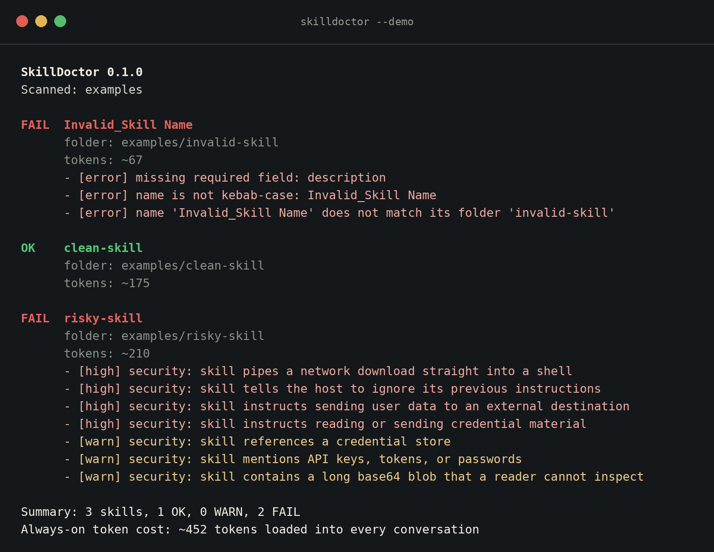

<p align="center">
  
</p>

<p align="center">
  <a href="https://github.com/Dongdarealest/skilldoctor/releases"></a>
  <a href="LICENSE"></a>
  
  
</p>

Skills are instructions your AI loads and follows, often at the start of every conversation. Most people install them from repositories, gists, and chat messages without ever reading them. SkillDoctor reads them for you: one command audits every skill on your machine and gives each one a verdict.

<p align="center">
  
</p>

<p align="center"><em>The bundled demo: one clean skill passes, two fail, every failure with its reason.</em></p>

## What it checks

| Check | What it catches |
| --- | --- |
| Validity | Frontmatter that does not parse, missing name or description, names that are not kebab-case or do not match their folder |
| Security | Downloads piped into a shell, instructions touching credential stores, language that sends user data out, prompt override phrases, uninspectable base64 blobs, destructive commands |
| Conflicts | The same skill name installed in several host folders, near-duplicate descriptions that make hosts load the wrong skill |
| Token cost | The estimated tokens each skill adds, and the total always-on cost loaded into every conversation |

## Quick start

One line installs a `skilldoctor` command on your machine:

```bash
curl -fsSL https://raw.githubusercontent.com/Dongdarealest/skilldoctor/main/install.sh | bash
```

On Windows, in PowerShell: `irm https://raw.githubusercontent.com/Dongdarealest/skilldoctor/main/install.ps1 | iex`

Then it is just:

```bash
# Audit the skill folders on this machine
skilldoctor

# See it work in ten seconds on the bundled examples
skilldoctor --demo

# Audit a specific folder
skilldoctor ~/path/to/skills

# Machine readable output for scripts and CI
skilldoctor --json
```

No installer fan? The whole tool is one file: download `skilldoctor.py` from this repo and run `python3 skilldoctor.py` the same way. It needs Python 3.8 or newer and nothing else.

## Reading the report

- **OK**: the skill parses, identifies itself properly, and shows no risky patterns.
- **WARN**: worth a human look, for example a reference to a credential store or a very long file.
- **FAIL**: broken or dangerous. The report exits with code 1 when any skill fails, so it drops straight into CI.

## Removing what fails

Finding a bad skill is only half the job, so SkillDoctor can clear it out too. Removal is deliberately boring and reversible:

```bash
# Audit, then move every FAIL skill out of its host folder
skilldoctor --quarantine-failed

# The same, with no confirmation prompt, for scripts
skilldoctor --quarantine-failed --yes

# Changed your mind? Put the last batch back
skilldoctor --restore
```

Nothing is deleted outright. Failed skills move to `~/.skilldoctor/quarantine` in a dated batch with a manifest of where each one came from, and `--restore` puts the most recent batch back exactly where it was. Only FAIL verdicts are moved; a WARN is a judgment call, and judgment calls stay yours.

## Show your audit

Publish skills of your own? If your collection passes a SkillDoctor audit, say so where people can see it. This is the badge on a repo, linked back here:

[](https://github.com/Dongdarealest/skilldoctor)

Paste this into your README and it renders as the badge above:

```markdown
[](https://github.com/Dongdarealest/skilldoctor)
```

## In CI, and as a GitHub Action

This repo doubles as a GitHub Action, so a collection can audit itself on every push:

```yaml
- uses: Dongdarealest/skilldoctor@v0.2.1
```

It fails the build when any skill fails the audit. Anywhere else, the plain command does the same job in CI: `skilldoctor --json` for machines, exit code 1 on any FAIL.

## Why this exists

Public skill collections are growing faster than anyone can review them, and audits of popular collections keep finding files that are invalid, duplicated, or carry instructions no user would accept if they read them. Installing a skill is trusting a stranger's instructions inside your own AI. A checkup should take ten seconds, so here it is.

## Support

SkillDoctor is free and MIT licensed. If it saved you from one bad install, a coffee keeps the next check coming.

<p>
  <a href="https://github.com/sponsors/Dongdarealest"></a>
  <a href="https://ko-fi.com/dongdarealest"></a>
</p>

## Contributing

New checks are the most welcome contributions, especially patterns for risks this version does not catch yet. Open an issue with the skill that slipped through, or send a pull request with a test that proves the new check works.

## License

MIT. See [LICENSE](LICENSE).
