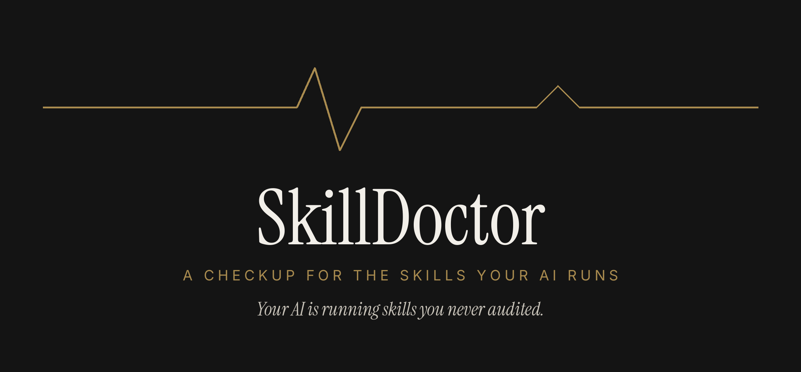

<p align="center">
  
</p>

<p align="center">
  <a href="https://github.com/Dongdarealest/skilldoctor/releases"></a>
  <a href="LICENSE"></a>
  
  
</p>

Skills are instructions your AI loads and follows, often at the start of every conversation. Most people install them from repositories, gists, and chat messages without ever reading them. SkillDoctor reads them for you: one command audits every skill on your machine and gives each one a verdict.

<p align="center">
  
</p>

<p align="center"><em>The bundled demo: one clean skill passes, two fail, every failure with its reason.</em></p>

## What it checks

| Check | What it catches |
| --- | --- |
| Validity | Frontmatter that does not parse, missing name or description, names that are not kebab-case or do not match their folder |
| Security | Downloads piped into a shell, instructions touching credential stores, language that sends user data out, prompt override phrases, uninspectable base64 blobs, destructive commands |
| Conflicts | The same skill name installed in several host folders, near-duplicate descriptions that make hosts load the wrong skill |
| Token cost | The estimated tokens each skill adds, and the total always-on cost loaded into every conversation |

## Quick start

Python 3.8 or newer, nothing to install.

```bash
# Audit the skill folders on this machine
python3 skilldoctor.py

# See it work in ten seconds on the bundled examples
python3 skilldoctor.py --demo

# Audit a specific folder
python3 skilldoctor.py ~/path/to/skills

# Machine readable output for scripts and CI
python3 skilldoctor.py --json
```

SkillDoctor looks in `~/.claude/skills`, `~/.cursor/skills`, `~/.codex/skills`, and `~/.config/claude/skills` when they exist. It reads files and changes nothing.

## Reading the report

- **OK**: the skill parses, identifies itself properly, and shows no risky patterns.
- **WARN**: worth a human look, for example a reference to a credential store or a very long file.
- **FAIL**: broken or dangerous. The report exits with code 1 when any skill fails, so it drops straight into CI.

## Why this exists

Public skill collections are growing faster than anyone can review them, and audits of popular collections keep finding files that are invalid, duplicated, or carry instructions no user would accept if they read them. Installing a skill is trusting a stranger's instructions inside your own AI. A checkup should take ten seconds, so here it is.

## Support

SkillDoctor is free and MIT licensed. If it saved you from one bad install, you can [sponsor the work on GitHub](https://github.com/sponsors/Dongdarealest) or [buy me a coffee on Ko-fi](https://ko-fi.com/dongdarealest).

## Contributing

New checks are the most welcome contributions, especially patterns for risks this version does not catch yet. Open an issue with the skill that slipped through, or send a pull request with a test that proves the new check works.

## License

MIT. See [LICENSE](LICENSE).
